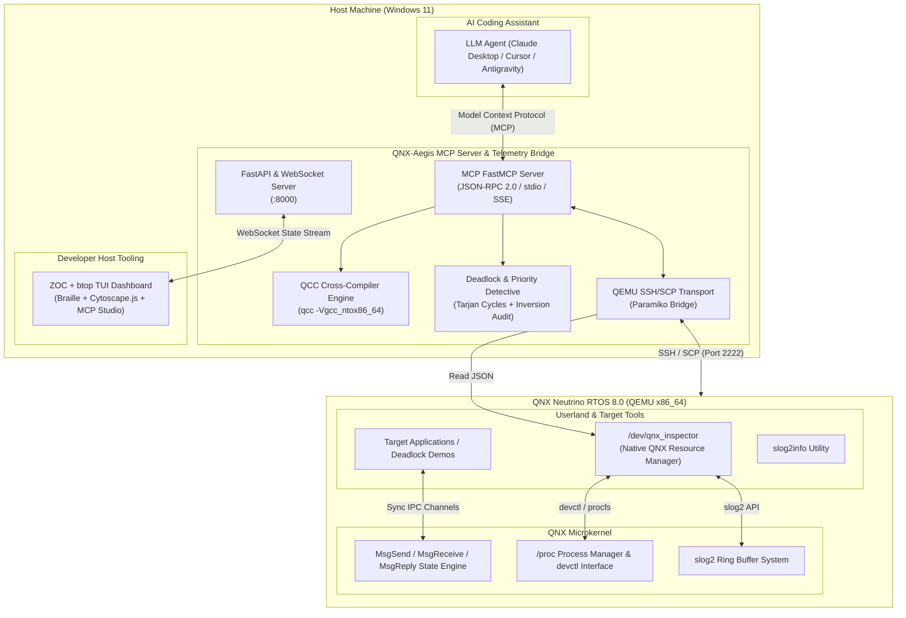

# QNX-Aegis (QNX-MCP Studio)
### Autonomous AI Agent & Real-Time Microkernel Bridge for QNX Neutrino RTOS 8.0

[](https://opensource.org/licenses/MIT)
[](https://blackberry.qnx.com/en/products/neutrino-rtos)
[-blue.svg)]()
[](https://modelcontextprotocol.io/)
[]()

> **QNX Global Hackathon Submission**  
> **Track:** Track 4: Developer Tooling & Host Tools  
> **Bonus Categories:** Best Use of QNX-Specific Technologies & Best Codelab/Tutorial

---

## 1. Executive Summary & Problem Statement

Developing safety-critical real-time applications on the **QNX Neutrino RTOS 8.0 microkernel** requires deep understanding of QNX's unique synchronous message-passing primitives (`MsgSendv`, `MsgReceivev`, `MsgReplyv`). Unlike monolithic operating systems (Linux, Windows) where threads typically block on OS mutexes or file descriptors, QNX threads spend significant portions of their lifecycle in microkernel IPC blocking states:
- `STATE_SEND`: Thread has called `MsgSend()`, waiting for the server to call `MsgReceive()`.
- `STATE_RECEIVE`: Server has called `MsgReceive()`, waiting for an incoming message on its channel.
- `STATE_REPLY`: Server has received message, client is blocked waiting for `MsgReply()`.

When complex distributed actor systems or resource managers communicate across mutual channels, **circular IPC deadlocks** can occur (Thread A `REPLY`-blocked on Thread B, while Thread B is `SEND`-blocked or `REPLY`-blocked on Thread A). These deadlocks cannot be detected by standard POSIX gdb watchdogs or external Linux debugging tools.

**QNX-Aegis** bridges this gap by marrying modern **AI Developer Agents** (via Anthropic's **Model Context Protocol - MCP**) directly with the **QNX 8.0 Microkernel**:
1. **Target Side (`qnx-target/`):** A lightweight C Resource Manager daemon exposing `/dev/qnx_inspector`. It inspects kernel thread states via `/proc`, reconstructs the IPC channel dependency graph, and queries the `slog2` high-performance ring buffer.
2. **Host Side (`mcp-server/`):** An MCP server & FastAPI telemetry bridge running on Windows. It orchestrates `qcc` cross-compilation (`-Vgcc_ntox86_64`), manages QEMU deployment over SSH, executes graph cycle detection algorithms to pinpoint exact circular wait chains, and exposes structured diagnostic tools directly to AI models (Claude, Cursor, Antigravity).
3. **ZOC Workstation + `btop` TUI Dashboard (`dashboard/`):** A three-tab dark terminal interface (`1: btop-kernel-monitor`, `2: ipc-cytoscape-topology`, `3: mcp-jsonrpc-studio`) with Unicode Braille sparklines, ASCII meters, searchable `⁴proc (pidin)` two-way Cytoscape sync, Priority Inversion auditing, hardware `ClockCycles()` IPC benchmarking, and One-Click QCC AI Hot-Patching under a strict zero-simulation policy.

---

## 2. System Architecture



---

## 3. Evidence of QNX 8.0 Use

QNX-Aegis is purpose-built for **QNX Neutrino RTOS 8.0** and relies fundamentally on core QNX microkernel technologies that do not exist in general POSIX or Linux environments.

| QNX 8.0 Technology | Target Source File | Exact APIs & Mechanisms Used | Description |
|---|---|---|---|
| **QNX Resource Manager** | [`qnx-target/inspector-daemon/main.c`](file:///d:/UIT/NamBonUIT/QNX-Aegis/qnx-target/inspector-daemon/main.c) | `dispatch_create()`, `resmgr_attach()`, `iofunc_func_init()`, `resmgr_context_alloc()`, `resmgr_block()` | Registers `/dev/qnx_inspector` in the QNX namespace to provide zero-copy JSON telemetry streaming via standard `io_read` callbacks. |
| **QNX Native IPC Passing** | [`qnx-target/demos/ipc_deadlock_demo.c`](file:///d:/UIT/NamBonUIT/QNX-Aegis/qnx-target/demos/ipc_deadlock_demo.c)<br/>[`qnx-target/demos/ipc_healthy_demo.c`](file:///d:/UIT/NamBonUIT/QNX-Aegis/qnx-target/demos/ipc_healthy_demo.c)<br/>[`qnx-target/demos/ipc_benchmark_demo.c`](file:///d:/UIT/NamBonUIT/QNX-Aegis/qnx-target/demos/ipc_benchmark_demo.c) | `ChannelCreate()`, `ConnectAttach()`, `MsgSend()`, `MsgReceive()`, `MsgReply()` | Implements deterministic synchronous message transactions, mutual `STATE_REPLY` / `STATE_SEND` circular deadlocks, and 1,000-iteration 64B round-trip latency benchmarks. |
| **QNX Hardware Timing** | [`qnx-target/demos/ipc_benchmark_demo.c`](file:///d:/UIT/NamBonUIT/QNX-Aegis/qnx-target/demos/ipc_benchmark_demo.c) | `ClockCycles()`, `SYSPAGE_ENTRY(qtime)->cycles_per_sec` | Measures sub-microsecond kernel IPC round-trip latency directly from the x86_64/QNX system page cycle counter without synthetic timers. |
| **QNX slog2 (System Logger 2)** | [`qnx-target/inspector-daemon/slog2_reader.c`](file:///d:/UIT/NamBonUIT/QNX-Aegis/qnx-target/inspector-daemon/slog2_reader.c)<br/>[`qnx-target/demos/slog2_crash_demo.c`](file:///d:/UIT/NamBonUIT/QNX-Aegis/qnx-target/demos/slog2_crash_demo.c) | `slog2_register()`, `slog2f()`, `slog2c()`, `slog2_buffer_t` | Emits high-frequency zero-copy structured system logs into categorized QNX 8.0 slog2 ring buffers and reads them via `slog2info`. |
| **Microkernel Process Inspection & Scheduling Audit** | [`qnx-target/inspector-daemon/ipc_analyzer.c`](file:///d:/UIT/NamBonUIT/QNX-Aegis/qnx-target/inspector-daemon/ipc_analyzer.c)<br/>[`mcp-server/src/deadlock_detective.py`](file:///d:/UIT/NamBonUIT/QNX-Aegis/mcp-server/src/deadlock_detective.py) | `devctl(fd, DCMD_PROC_SYSINFO)`, `DCMD_PROC_TIDSTATUS`, `STATE_SEND`, `STATE_REPLY`, `STATE_RECEIVE` | Queries microkernel thread control blocks (`procnto`) directly to extract thread states, channel IDs, wait-for cycles, and scheduling priority inversions. |
| **QNX Cross-Compilation** | [`scripts/build-target.ps1`](file:///d:/UIT/NamBonUIT/QNX-Aegis/scripts/build-target.ps1)<br/>[`mcp-server/src/qcc_compiler.py`](file:///d:/UIT/NamBonUIT/QNX-Aegis/mcp-server/src/qcc_compiler.py) | `qcc -Vgcc_ntox86_64`, `qcc -Vllvm_ntox86_64`, `-lslog2` | Uses native QNX SDP 8.0 cross-compiler drivers with target architecture specifications and QNX library linkers. |

---

## 4. Repository Structure

```
QNX-Aegis/
├── LICENSE                                  # MIT Open Source License
├── README.md                                # Hackathon Overview, Evidence & Instructions
├── .gitignore                               # Build artifacts & environment ignores
├── .env.example                             # Configuration blueprint
│
├── docs/
│   ├── ARCHITECTURE.md                      # Microkernel internals, IPC state machine & MCP architecture
│   └── CODELAB.md                           # 15-minute hands-on tutorial for Hackathon judges & developers
│
├── scripts/
│   ├── setup-env.ps1                        # Verifies QNX SDP 8.0, qcc in PATH, and Python environment
│   ├── build-target.ps1                     # Cross-compiles C binaries with qcc (-Vgcc_ntox86_64)
│   └── deploy-to-qemu.ps1                   # Deploys binaries to QNX 8.0 QEMU via SCP
│
├── qnx-target/                              # Native QNX C source code
│   ├── Makefile                             # Target Makefile calling qcc
│   ├── inspector-daemon/                    # QNX Resource Manager (/dev/qnx_inspector)
│   │   ├── Makefile
│   │   ├── qnx_inspector.h                  # Process, Thread, IPC & Slog2 data structures
│   │   ├── main.c                           # Resource Manager setup (resmgr_attach) & io_read
│   │   ├── ipc_analyzer.c                   # Thread state parser (/proc devctl)
│   │   └── slog2_reader.c                   # slog2 ring buffer extractor
│   └── demos/                               # Diagnostic & demo binaries
│       ├── Makefile
│       ├── ipc_deadlock_demo.c              # Intentional circular MsgSend deadlock
│       ├── ipc_benchmark_demo.c             # ClockCycles() 1,000x 64B MsgSend benchmark
│       ├── ipc_healthy_demo.c               # Clean ChannelCreate / MsgSend / MsgReply loop
│       └── slog2_crash_demo.c               # Slog2 warning logger + deliberate fault trigger
│
├── mcp-server/                              # Host-side Python Model Context Protocol Service
│   ├── pyproject.toml                       # Python package configuration
│   ├── requirements.txt                     # Dependencies: mcp, fastapi, paramiko, etc.
│   └── src/
│       ├── config.py                        # Environment parser
│       ├── qcc_compiler.py                  # qcc wrapper with structured compiler diagnostics
│       ├── qemu_bridge.py                   # SSH/SCP client communicating with QNX VM
│       ├── deadlock_detective.py            # Directed graph cycle detection for QNX IPC
│       ├── server.py                        # FastMCP tool implementation
│       └── api_bridge.py                    # FastAPI & WebSocket server for live dashboard
│
└── dashboard/                               # Real-Time Visualizer
    ├── index.html                           # Single-page responsive dark-mode UI
    ├── app.js                               # WebSocket receiver & Cytoscape.js IPC graph layout
    └── styles.css                           # Microkernel status colors & glowing telemetry styles
```

---

## 5. Quickstart Guide

### Prerequisites
1. **Windows 10/11 Host** with:
   - **QNX SDP 8.0** installed (typically `C:\QNX800`).
   - **Python 3.10+** installed.
   - **QEMU** running QNX Neutrino RTOS 8.0 (`x86_64` target), with SSH port forwarding enabled (host port `2222` -> guest port `22` or `2222`). Default user: `qnxuser` / password: `qnxuser`.

### Step 1: Environment Initialization
Open PowerShell as Administrator or regular user:
```powershell
# 1. Clone or navigate to the repository
cd d:\UIT\NamBonUIT\QNX-Aegis

# 2. Copy and configure environment variables
Copy-Item .env.example .env

# 3. Run the setup validation script
.\scripts\setup-env.ps1
```

### Step 2: Cross-Compile Target Binaries
Cross-compile the native QNX Resource Manager and Demo applications using `qcc`:
```powershell
.\scripts\build-target.ps1
```
This produces `qnx_inspector`, `ipc_deadlock_demo`, `ipc_healthy_demo`, `ipc_benchmark_demo`, and `slog2_crash_demo` inside `qnx-target/bin/`.

### Step 3: Deploy to QNX 8.0 QEMU
Deploy the cross-compiled binaries to the target VM over SSH/SCP:
```powershell
.\scripts\deploy-to-qemu.ps1
```

### Step 4: Launch Host MCP Server & Live Dashboard
1. Set up the Python virtual environment:
```powershell
cd mcp-server
python -m venv venv
.\venv\Scripts\Activate.ps1
pip install -r requirements.txt
```

2. Run the MCP Server & Dashboard API Bridge:
```powershell
python -m src.api_bridge
```

3. Open your browser and navigate to:
```
http://localhost:8000
```
You will see the live **QNX-Aegis ZOC + `btop` Workstation** with three session tabs (`1: btop-kernel-monitor`, `2: ipc-cytoscape-topology`, `3: mcp-jsonrpc-studio`) displaying Unicode Braille kernel telemetry, searchable `⁴proc (pidin)` threads synchronized with Cytoscape.js, Priority Inversion auditing, `ClockCycles()` IPC benchmarks, One-Click QCC AI Hot-Patching, and the streaming `slog2` log console.

---

## 6. Model Context Protocol (MCP) AI Tools

QNX-Aegis exposes 6 standard MCP tools to AI assistants:

| MCP Tool Name | Parameters | Purpose |
|---|---|---|
| `qnx_verify_environment` | *none* | Verifies host `qcc` compiler path and tests SSH connectivity to QNX QEMU. |
| `qnx_compile_source` | `source_path`, `output_binary`, `extra_flags` | Cross-compiles C source on host via `qcc -Vgcc_ntox86_64` and returns compiler warnings/errors. |
| `qnx_deploy_and_execute` | `local_binary`, `remote_path`, `timeout_sec` | Transmits binary to QNX via SCP, sets execute permissions (`chmod +x`), and executes in background or foreground. |
| `qnx_inspect_microkernel` | *none* | Reads `/dev/qnx_inspector` and `pidin` to extract live process and thread states (`REPLY`, `SEND`, `RECEIVE`). |
| `qnx_detect_ipc_deadlock` | *none* | Builds directed graph of thread IPC waits and pinpoints exact circular deadlocks (e.g., `TID 1 -> TID 2 -> TID 1`). |
| `qnx_read_slog2` | `lines` (default 50) | Queries the QNX system logger (`slog2info`) for latest error messages and diagnostic buffer records. |

### Connecting to Claude Desktop / Cursor
Add the following snippet to your `claude_desktop_config.json`:
```json
{
  "mcpServers": {
    "qnx-aegis": {
      "command": "python",
      "args": [
        "-m",
        "src.server"
      ],
      "cwd": "d:/UIT/NamBonUIT/QNX-Aegis/mcp-server",
      "env": {
        "PYTHONPATH": "d:/UIT/NamBonUIT/QNX-Aegis/mcp-server"
      }
    }
  }
}
```

---

## 7. Interactive Demonstrations & Workstation APIs

1. **Trigger Deadlock & Observe TUI Visuals:** Click **DEADLOCK** on the ZOC bookmark bar or invoke `qnx_deploy_and_execute` with `ipc_deadlock_demo`. Cytoscape nodes shift to deadlocked red edges while `³deadlock-detective` raises `[CRITICAL]` and `deadlock_detective.py` simultaneously audits any scheduling **Priority Inversions** (`priority_inversions` / `priority_inversion_count`).
2. **One-Click QCC AI Hot-Patching (`POST /api/remediate/deadlock`):** Click **AI HOT-PATCH** in the bookmark bar or remediation card to automatically slay `ipc_deadlock_demo`, recompile `ipc_healthy_demo.c` cleanly with `qcc -Vgcc_ntox86_64`, deploy via SCP to the QNX 8.0 target, and restore healthy microkernel execution.
3. **Hardware `ClockCycles()` IPC Benchmark (`POST /api/trigger/benchmark`):** Click **IPC BENCH** to execute 1,000 synchronous 64-byte `MsgSend()` / `MsgReceive()` / `MsgReply()` round-trips on QNX 8.0, reading `ClockCycles()` and `SYSPAGE_ENTRY(qtime)->cycles_per_sec` to compute sub-microsecond latency (`ns`) and throughput (`msg/s`).
4. **Interactive MCP JSON-RPC Studio (`GET /api/mcp/tools`, `POST /api/mcp/call`):** Switch to Tab `3: mcp-jsonrpc-studio` to inspect live FastMCP tool schemas, compose JSON arguments, and execute MCP tools or REST endpoints directly in-browser with latency metrics.
5. **Agentic Resolution Workflow:** Ask Claude Desktop / Cursor / Antigravity to call `qnx_detect_ipc_deadlock`, `qnx_compile_source`, and `qnx_deploy_and_execute` for autonomous end-to-end remediation.

---

## 8. License

This project is licensed under the MIT License - see the [LICENSE](LICENSE) file for details. Built with ❤️ for the QNX Global Hackathon.
