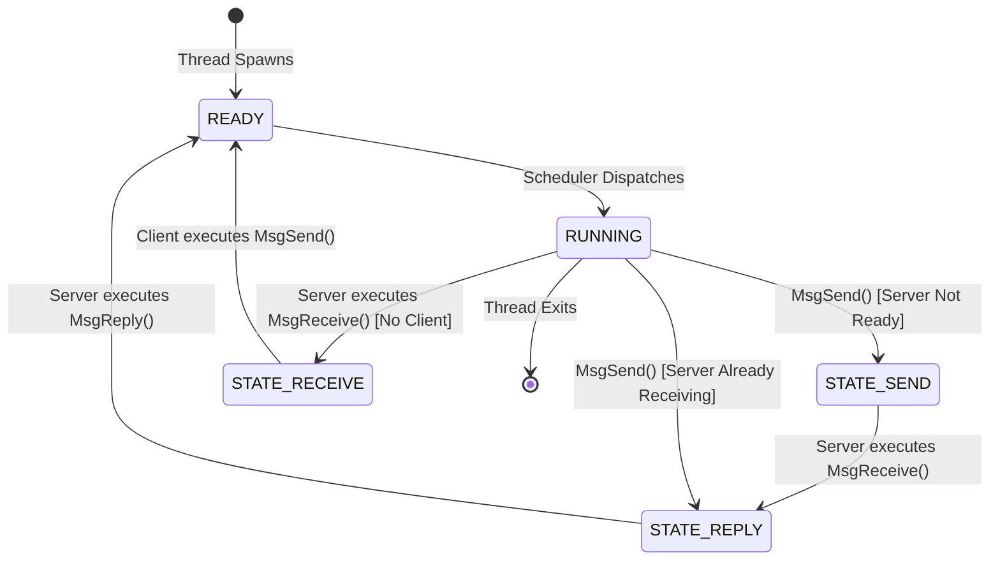
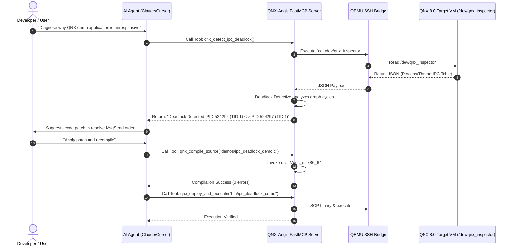

# QNX-Aegis System Architecture
### Deep-Dive into QNX 8.0 Microkernel IPC, Resource Managers, and AI Developer Bridge

---

## 1. The QNX Neutrino RTOS 8.0 Microkernel Paradigm

The QNX Neutrino RTOS 8.0 is a true microkernel operating system. Unlike monolithic kernels (Linux, FreeBSD, Windows NT) where drivers, filesystems, networking stacks, and graphics subsystems execute in kernel space (Ring 0), QNX runs only core primitives in Ring 0:
- **Thread services:** Thread creation, destruction, and scheduling.
- **Message passing services:** IPC message delivery, buffer routing, channel mapping.
- **Synchronization services:** Mutexes, semaphores, condition variables.
- **Interrupt handling:** Dispatching hardware interrupt events to user-space handlers.
- **Timer services:** High-resolution timers and clock tick handling.

All other services—including the Process Manager (`procnto`), filesystems, device drivers, network stacks, and user applications—run as isolated user-space processes (Ring 3) communicating strictly via **synchronous message passing**.

```mermaid
graph TD
    subgraph UserSpace["QNX 8.0 User Space (Ring 3)"]
        App1["Target App (Client)"]
        ResMgr["/dev/qnx_inspector<br/>(Resource Manager)"]
        ProcMgr["procnto (Process Manager)"]
        IoPkt["io-pkt-v6 (Network Stack)"]
        Slog2["slog2 Ring Buffers"]
    end

    subgraph KernelSpace["QNX Microkernel (Ring 0)"]
        Sched["Thread Scheduler"]
        IPC["Message Passing Engine<br/>(MsgSend, MsgReceive, MsgReply)"]
        Sync["Sync Primitives"]
        Intr["Interrupt Handlers"]
    end

    App1 <-->|MsgSend / MsgReply| ResMgr
    ResMgr <-->|devctl /proc| ProcMgr
    App1 -->|slog2fa()| Slog2
    ResMgr -->|Kernel IPC| IPC
    ProcMgr -->|Kernel IPC| IPC
```

---

## 2. QNX Native IPC State Machine

In QNX Neutrino, message passing is fundamentally **synchronous and unbuffered**:
1. When a client thread executes `MsgSend(coid, &smsg, sbytes, &rmsg, rbytes)`:
   - If the server has not called `MsgReceive()`, the client enters **`STATE_SEND`** blocking state.
   - If the server is already waiting in `MsgReceive()`, the microkernel copies the message directly from the client's address space to the server's address space (zero-copy when memory-mapped or single copy). The server becomes `READY` / `RUNNING`, and the client enters **`STATE_REPLY`** blocking state.
2. The server processes the request and executes `MsgReply(rcvid, status, &rmsg, rbytes)`.
3. The microkernel copies the response back to the client and transitions the client to `STATE_READY` / `STATE_RUNNING`.



### The Problem: Circular Deadlock in Microkernel Architectures
In a distributed microkernel system, if **Thread A** calls `MsgSend()` to a channel owned by **Thread B** (entering `STATE_REPLY`), and **Thread B** simultaneously (or via an intermediary **Thread C**) calls `MsgSend()` back to **Thread A** before calling `MsgReply()`, both threads become permanently blocked:
- **Thread A** is `REPLY`-blocked on **Thread B**.
- **Thread B** is `SEND`-blocked or `REPLY`-blocked on **Thread A**.
- **Neither thread can execute code to call `MsgReply()` or `MsgReceive()`.**

Standard POSIX debuggers and Linux trace tools cannot parse these microkernel-level channel associations. **QNX-Aegis** directly reads the microkernel process table via `/proc` and detects these circular dependencies.

---

## 3. QNX-Aegis Native Resource Manager: `/dev/qnx_inspector`

To avoid intrusive kernel hooks or external debugging overhead, QNX-Aegis provides a native QNX C Resource Manager daemon (`qnx_inspector`).

### 3.1 Resource Manager Lifecycle
A QNX Resource Manager utilizes the QNX Dispatch Interface (`sys/dispatch.h` and `sys/resmgr.h`):

1. **`dispatch_create()`**: Allocates a dispatch structure to handle POSIX messages.
2. **`iofunc_func_init()` & `resmgr_connect_funcs_t` / `resmgr_io_funcs_t`**: Initializes POSIX standard handler tables (`open`, `read`, `write`, `close`, `devctl`).
3. **`resmgr_attach()`**: Registers the pathname `/dev/qnx_inspector` in the QNX pathname space. The Process Manager automatically maps any client calling `open("/dev/qnx_inspector")` to our daemon's channel ID.
4. **`resmgr_block()` & `resmgr_handler()`**: Runs the non-terminating event dispatch loop.

### 3.2 Dynamic JSON Generation in `io_read`
When any process (including our host SSH bridge via `cat /dev/qnx_inspector` or a local QNX tool) reads from `/dev/qnx_inspector`, the overridden `io_read` callback executes:
1. Queries `/proc` using `devctl(fd, DCMD_PROC_SYSINFO)` to retrieve CPU uptime and total threads.
2. Traverses all active processes in `/proc/<pid>/as` and queries `DCMD_PROC_TIDSTATUS` to capture:
   - PID, TID, process name.
   - Exact QNX thread state (`STATE_SEND`, `STATE_RECEIVE`, `STATE_REPLY`, `STATE_RUNNING`, etc.).
   - Blocked Channel ID (`chid`) and Connection ID (`coid`).
   - Target PID/TID if `REPLY`-blocked.
3. Formats this snapshot into a compact, zero-overhead JSON string and transfers it to the client buffer with `_IO_SET_READ_NBYTES`.

---

## 4. Deadlock Detective Algorithm

On the host side, the `deadlock_detective.py` module continuously consumes the microkernel state snapshots and evaluates the IPC dependency graph.

### Formal Graph Representation
Let the microkernel state at time $t$ be represented as a directed graph $G = (V, E)$:
- **Vertices $V$:** Active threads $T_{p, t} = (\text{PID } p, \text{TID } t)$.
- **Edges $E$:** A directed edge $(T_A, T_B) \in E$ exists if and only if $T_A$ is blocked waiting on an action from $T_B$:
  - $T_A$ is in `STATE_REPLY` and $T_B$ is the server thread assigned to reply to $T_A$'s message.
  - $T_A$ is in `STATE_SEND` on a channel owned by the process containing $T_B$.

### Cycle Detection Execution
We apply **Tarjan’s Strongly Connected Components (SCC)** algorithm or depth-first search (DFS) with a recursion stack:
1. For each unvisited node $u \in V$, execute `DFS(u)`.
2. Maintain `visited` set and `recursion_stack` set.
3. If an edge points to a node currently in `recursion_stack`, a **directed cycle is detected**.
4. Extract the exact cycle path:
   $$\text{Cycle: } T_{101, 1} \xrightarrow{\text{STATE\_REPLY (chid=2)}} T_{102, 1} \xrightarrow{\text{STATE\_SEND (chid=1)}} T_{101, 1}$$
5. Format the diagnostic report and broadcast an alert via WebSocket to the live dashboard and MCP agent.

---

## 5. Model Context Protocol (MCP) Bridge

The Model Context Protocol (developed by Anthropic) standardizes how LLMs interact with external development environments, compilers, and telemetry sources.



---

## 6. Live Dashboard & WebSocket Telemetry Engine

The live dashboard is an ultra-lightweight, zero-build HTML5 application:
- **FastAPI / WebSocket Backend (`api_bridge.py`):** Runs a background asyncio worker polling `/dev/qnx_inspector` and `slog2info` every 2 seconds, transforming raw data into an IPC node-edge graph and streaming updates over `/ws/telemetry`.
- **Frontend Engine (`app.js` + Cytoscape.js):** 
  - Dynamic physics-based graph rendering.
  - Color-coded node statuses (Green = `RUNNING`/`READY`, Blue = `RECEIVE`-blocked, Amber = `SEND`-blocked, Red = `REPLY`-blocked).
  - Red pulsing edges highlight deadlock cycles.
  - Streaming `slog2` log viewer with severity filtering (`INFO`, `WARN`, `CRITICAL`).
